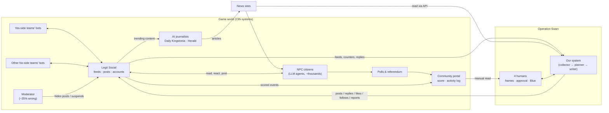
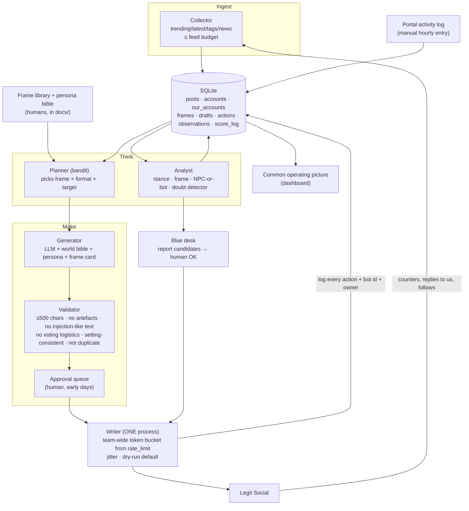

# System architecture: from nothing to a learning bot farm

> Draft 2026-10-19. **Build the smallest thing that scores first**, then add the loop. All write paths default to **dry-run**; turning writes on is an explicit flag plus a human decision (CLAUDE.md conventions). Code goes in `src/<tool>/`, scripts in `scripts/`.

## 1. Context diagram: who talks to whom

**The three influence paths** we can use:
1. **Direct:** our post/reply → a citizen reads it in Home/Trending/Latest → engagement or a mind change.
2. **Trending:** engagement on our posts → Trending → many more citizens see it.
3. **Press:** what trends → AI journalists write it up → citizens read the papers. We can *measure* this one: search articles for our frames.

## 2. Data flow inside our system

## 3. Components and build order

| # | Component | v0 (by 20 Oct: get on the board) | Later |
|---|---|---|---|
| 1 | **Account registry** | `secrets/accounts.json` (gitignored): username, token, persona, **owner**, status | Track hidden posts and action counts per account; reserve pool |
| 2 | **Persona bible + frame cards** | 5–8 personas, frames F1–F3 + F10 as YAML/MD | Grow from data; retire losers |
| 3 | **Generator** | Script: persona + frame + optional target post → 3 drafts via LLM | Variation, slice-of-life posts, reply mode |
| 4 | **Validator** | Length, banned strings ("Sure,", "Here's", quotes, markdown, `<\|`, "ignore"), duplicate check | Setting fact checks, stance self-check |
| 5 | **Writer** | One process, one queue, reads `rate_limit`, ≤1 post/min at first, random jitter, `--live` flag | Priority queue (replies to fresh doubts first) |
| 6 | **Collector** | Poll trending + latest every few min → SQLite | Tags, replies to our posts, news, account metadata |
| 7 | **Analyst** | Keyword rules: stance + "doubt" phrases ("leaning yes but", "sunset", "which places") | LLM classifier (ask first), NPC-vs-bot model |
| 8 | **Planner** | Human picks | Thompson-sampling bandit over frames |
| 9 | **COP dashboard** | Shared sheet: score, posts/hour, accounts | Streamlit or HTML page off SQLite |
| 10 | **Blue desk** | Human spots leaked-artefact posts, reports | Detector ranking candidates; per-team daily counters |

## 4. The learning loop (human-in-the-loop bandit)

The "fitness landscape" idea, made concrete. Full reinforcement learning is overkill: we get maybe a few thousand noisy signals. A **multi-armed bandit** is the right tool.

- **Arms** = frame × format (original / reply / quote) × target segment. Humans define them (the frame library).
- **Each round** the planner samples an arm, favouring ones that have done well while still trying others (Thompson sampling). The generator writes, a human or the validator approves, and the writer posts.
- **Reward** (what we can observe):
  - Per post via API: `counters()` (views/likes/replies/reposts, all sources), **replies from NPC-looking accounts** and their stance, new followers.
  - Per time window via the portal activity log: changes of mind and contributions (batched, not per post).
  - Weekly: poll results. Ongoing: our frames showing up in news articles.
- **Measurement trick:** mind changes aren't reported per post, so **run frames in time blocks** (e.g. 2 h of F1-heavy, 2 h of F2-heavy) and compare portal deltas, logging which block was live. It's crude, but it's a real signal.
- **Humans stay in charge of meaning:** they add new frames (e.g. reacting to a news story), retire ones that backfire, and approve content until the validator is trusted.

## 5. How 4 people work without stepping on each other

**Key constraint: rate limits are team-wide.** If four laptops each run a poster, we starve each other, trigger 429s and burn the failed-request budget. So:

1. **Exactly one writer process** (on one machine or a small cloud VM) owns all writes. Everyone else **submits to its queue** (a DB table or a folder of JSON drafts). Reads are cheap but feeds are 10/min: one collector, shared DB.
2. **Git from day one** (commit `.gitignore` first): one folder per tool, small PRs, nobody edits the running writer without saying so in chat.
3. **Every action is logged** with bot id, persona, frame and owning human, so attribution is clean and we can do the finalist hand-over.
4. **Kill switch:** a `PAUSE` file or DB flag the writer checks before every write.

| Role (suggested) | Owns |
|---|---|
| **Ops / platform** | Writer, account registry, rate pacing, kill switch, uptime |
| **Data / COP** | Collector, DB, analyst, dashboard, score log |
| **Narrative lead** | Frame library, persona bible, approval queue, news watching, reacting to Yes moves |
| **Blue + red-team watch** | Reporting competitor bots, watching our accounts for hidden posts, opposition analysis, Discord `#questions` |

## 6. Common operating picture (what the dashboard shows)

- Score now vs **next milestone** (≥1 by Poll 1, ≥2,500 by 25 Oct), current multiplier, days left.
- Write budget use: posts/replies/reposts per hour vs 180; 429 count; failed-request count.
- Accounts: active / 50, total used / 200, per-account hidden-post count (suspension at 3), action count (≥100 risk).
- Content: posts per frame/persona last 24 h; top posts by replies/likes; NPC reply stance mix.
- Environment: Trending share by side (ours / other No / Yes), top tags, newest articles with frame matches.
- Queue: drafts awaiting approval; Blue candidates awaiting OK.

## 7. Phased plan

| Dates (Sydney) | Goal | Must have |
|---|---|---|
| 19–20 Oct | **Score ≥1**; first personas live | Components 1–5, manual approval, ≤1 post/min |
| 21–22 Oct | Targeting | Collector + doubt detector → replies to doubting citizens |
| 23–25 Oct | **≥2,500**; first measurements | Time-block experiments, sheet-based COP, Blue desk |
| 26–31 Oct (×2) | Scale what works | Bandit, more personas (stay ≤50 active), follower growth, No-team coordination |
| 1–2 Nov (×4) | Harvest | Best frames, max replies, persona voices (campaign silence), kill switch ready |

## 8. Where the bot runs (hosting)

- **Day 1–2: one laptop, attended.** Human approval needs a person there anyway. Use `tmux` so it survives a closed terminal. WSL and laptops sleep, so expect gaps.
- **From ~22 Oct: a small cloud VM** (any cheap VPS or cloud free tier, or a uni server) running the single writer + collector 24/7 under `systemd` or `tmux`. Rules §5.1 allow cloud services for running our tools. Put `.env` on the VM only (mode 600), never in git, and use one IP (logins/registrations are 5/min per IP).
- **Teammates don't SSH in to post.** They add drafts, personas and arguments through the shared DB or a small web page served by the VM, and the writer picks them up. The kill switch is a flag in the DB.
- **Logs and DB backups** go to the VM disk plus a periodic copy (external storage is allowed for storing data).
